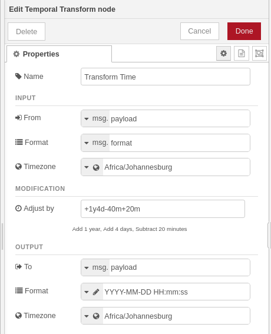

# node-red-temporal

A Node-RED plugin for parsing, converting, adjusting, and computing durations between date/time values. Built on the [TC39 Temporal API](https://tc39.es/proposal-temporal/) via [`temporal-polyfill`](https://www.npmjs.com/package/temporal-polyfill).

---

> [!IMPORTANT]
> **This plugin requires [`@theotherwillembotha/node-red-plugincore`](https://github.com/theotherwillembotha/nodered_plugincore) to be installed.**
>
> `node-red-plugincore` is declared as a dependency and npm will install it automatically alongside this package. However, due to a [known Node-RED limitation](https://github.com/node-red/node-red/issues/3529), packages that arrive as transitive npm dependencies are only discovered by the Node-RED runtime on the **next startup**.
>
> **You have two options:**
> - Install [`@theotherwillembotha/node-red-plugincore`](https://flows.nodered.org/node/@theotherwillembotha/node-red-plugincore) via the palette manager or `npm install` **first**, then install this plugin — both will be available immediately without a restart.
> - Install this plugin directly — `node-red-plugincore` will be installed automatically alongside it. **Restart Node-RED** once and both packages will be fully loaded.

---

## Nodes

### Temporal Transform

Transforms a date/time value from one representation to another in a single node. Supports:

- Reading from `msg`, `flow`, `global` context, or the current timestamp
- Parsing all common date/time formats, including custom format strings
- Timezone-aware conversion using IANA timezone names or UTC offset strings
- Optional time adjustment (add/subtract years, months, weeks, days, hours, minutes, seconds, milliseconds)
- Writing the result back to `msg`, `flow`, or `global` context in any supported format



---

### Temporal Duration

Computes the duration between two date/time values. Supports:

- Reading each endpoint from `msg`, `flow`, `global` context, the current timestamp, or the **previous message** (interval measurement mode)
- An optional offset to shift the computed duration before output
- Four output modes: total in a single unit, broken-down components object, ISO 8601 duration string, or human-readable text
- Writing the result to `msg`, `flow`, or `global` context


---

## Installation

```bash
npm install @theotherwillembotha/node-red-temporal
```

Or search for `node-red-temporal` in the Node-RED palette manager.

**Requirements:** Node.js ≥ 18, Node-RED ≥ 4.0.0

---

## Temporal Transform — field reference

### Input section

| Field | Description |
|-------|-------------|
| **From** | Where to read the date/time value. Supports `msg`, `flow`, and `global` properties, or **timestamp (now)** to capture the current time at the moment the message is received. |
| **Format** | How the input value is encoded. Choose a named preset or enter a custom format string (see [Format reference](#format-reference) below). Can also be read dynamically from a `msg`, `flow`, or `global` property. |
| **Timezone** | The timezone the input value is expressed in. Required for formats that do not carry timezone information (`date`, `datetime`, `unix-s`, `unix-ms`, `rfc2822`, and custom formats). Accepts IANA names (e.g. `Europe/Amsterdam`) or UTC offset strings (e.g. `+02:00`). Can also be read from a `msg`, `flow`, or `global` property. |

> When **From** is set to **timestamp (now)** the Format field is automatically locked to **milliseconds since epoch** and the Input Timezone field has no effect.

---

### Modification section

| Field | Description |
|-------|-------------|
| **Adjust by** | An optional adjustment expression. Leave empty to pass the value through unchanged. See [Adjustment string syntax](#adjustment-string-syntax) below. |

The editor shows a live human-readable preview of the adjustment as you type (e.g. `+1y4d-40m+20m` → *Add 1 year, Add 4 days, Subtract 20 minutes*). Invalid expressions are highlighted in red and prevent the node from being saved.

---

### Output section

| Field | Description |
|-------|-------------|
| **To** | Where to write the result. Supports `msg`, `flow`, and `global` properties. |
| **Format** | How to encode the output value. Choose a named preset or enter a custom format string. Can also be read dynamically from a `msg`, `flow`, or `global` property. |
| **Timezone** | The timezone to express the output value in. Accepts IANA names or UTC offset strings. |

---

## Temporal Duration — field reference

### From Time / To Time sections

Each endpoint has the same three fields:

| Field | Description |
|-------|-------------|
| **From / To** | Where to read the date/time value. Supports `msg`, `flow`, and `global` properties, **timestamp (now)** to use the current time, or **previous message** (From only — see below). |
| **Format** | How the value is encoded. Choose a named preset or a custom format string. Disabled when **timestamp (now)** is selected. |
| **Timezone** | The IANA timezone or UTC offset the value is expressed in. Required for formats that carry no timezone information. |

The duration is always computed as **To − From** (positive when To is later than From).

#### Interval measurement — "previous message" mode

When **From** is set to **previous message**:

- The Format and Timezone fields for the From section are hidden — not needed, since the stored value is already a parsed `ZonedDateTime`.
- The **first message** arriving at the node stores the To time as the baseline and is **not forwarded**.
- Every **subsequent message** computes the duration from the stored baseline to the current To time, writes the output, then stores the current To time for the next message.
- The stored baseline is **reset when the flow is redeployed**.

This mode is useful for measuring the interval between recurring messages (e.g. sensor readings, heartbeats, pipeline throughput).

---

### Offset section

| Field | Description |
|-------|-------------|
| **Offset by** | An optional expression that shifts the computed duration before output. Uses the same syntax as the Temporal Transform adjustment string — see [Adjustment string syntax](#adjustment-string-syntax) below. |

---

### Output section

| Field | Description |
|-------|-------------|
| **To** | Where to write the result. Supports `msg`, `flow`, and `global` properties. |
| **Mode** | How to express the duration. See output modes below. |

#### Output modes

| Mode | Output type | Description |
|------|-------------|-------------|
| **Total in unit** | `number` | The entire duration expressed as a single numeric value in the selected unit (milliseconds, seconds, minutes, hours, or days). Fractional values are returned where applicable. |
| **Duration components** | `object` | A plain object with keys `years`, `months`, `weeks`, `days`, `hours`, `minutes`, `seconds`, `milliseconds`. The values are broken down from the selected **Largest unit** downward — fields for units larger than the largest unit are always zero. |
| **ISO 8601 string** | `string` | The duration as an ISO 8601 duration string, e.g. `P1Y2M3DT4H5M6S`. |
| **Human readable** | `string` | A locale-formatted string using `Intl.DurationFormat` with English locale and the selected style. |

**Human readable styles**

| Style | Example |
|-------|---------|
| Long | `2 hours, 30 minutes, 5 seconds` |
| Short | `2 hr., 30 min., 5 sec.` |
| Narrow | `2h 30m 5s` |

---

## Format reference

The following named presets are available for both input and output in the Temporal Transform node, and for both endpoint fields in the Temporal Duration node:

| Preset | Description | Example |
|--------|-------------|---------|
| `iso` | ISO 8601 with timezone offset | `2024-05-16T14:30:00+02:00` |
| `iso-utc` | ISO 8601 UTC (Zulu) | `2024-05-16T12:30:00.000Z` |
| `date` | Date only | `2024-05-16` |
| `datetime` | Date and local time (no timezone) | `2024-05-16 14:30:00` |
| `unix-s` | Seconds since epoch | `1715860200` |
| `unix-ms` | Milliseconds since epoch | `1715860200000` |
| `js-date` | JavaScript Date Object | *(Node.js `Date` instance)* |
| `rfc2822` | RFC 2822 email date format | `Thu, 16 May 2024 14:30:00 +0200` |

### Custom format strings

Select **custom** to enter a format string using Moment.js-style tokens. Tokens are case-sensitive and processed longest-first to prevent ambiguity (e.g. `MM` is always matched before `M`).

| Token | Description | Example output |
|-------|-------------|----------------|
| `YYYY` | 4-digit year | `2024` |
| `YY` | 2-digit year (20xx) | `24` |
| `MM` | Month, zero-padded (01–12) | `05` |
| `M` | Month, no padding (1–12) | `5` |
| `DD` | Day of month, zero-padded (01–31) | `06` |
| `D` | Day of month, no padding (1–31) | `6` |
| `HH` | Hour (24 h), zero-padded (00–23) | `14` |
| `H` | Hour (24 h), no padding (0–23) | `14` |
| `hh` | Hour (12 h), zero-padded (01–12) | `02` |
| `h` | Hour (12 h), no padding (1–12) | `2` |
| `mm` | Minute, zero-padded (00–59) | `30` |
| `m` | Minute, no padding (0–59) | `30` |
| `ss` | Second, zero-padded (00–59) | `05` |
| `s` | Second, no padding (0–59) | `5` |
| `SSS` | Milliseconds, zero-padded (000–999) | `047` |
| `A` | AM / PM (uppercase) | `PM` |
| `a` | am / pm (lowercase) | `pm` |

Any character in the format string that does not match a token is treated as a literal separator (e.g. `-`, `/`, ` `, `:`).

**Custom format examples**

| Format string | Example output |
|---------------|----------------|
| `YYYY-MM-DD` | `2024-05-16` |
| `DD/MM/YYYY` | `16/05/2024` |
| `DD/MM/YYYY HH:mm:ss` | `16/05/2024 14:30:05` |
| `YYYY-MM-DD HH:mm:ss.SSS` | `2024-05-16 14:30:05.047` |
| `hh:mm:ss A` | `02:30:05 PM` |
| `YYYY-MM-DDTHH:mm:ss` | `2024-05-16T14:30:05` |

> **Note:** Named month abbreviations (e.g. `Jan`, `Feb`) are not supported as tokens — the format system works with numeric values only.

---

## Adjustment string syntax

The **Adjust by** field (Temporal Transform) and **Offset by** field (Temporal Duration) accept the same expression syntax to shift a time or duration value.

### Units

| Token | Unit | Notes |
|-------|------|-------|
| `y` | Years | Calendar unit — result is clamped to the last valid day of the month |
| `M` | Months | Calendar unit — result is clamped to the last valid day of the month |
| `w` | Weeks | Equivalent to 7 days |
| `d` | Days | |
| `H` | Hours | |
| `m` | Minutes | |
| `s` | Seconds | |
| `S` | Milliseconds | |

> Tokens are **case-sensitive**: `M` is months, `m` is minutes; `H` is hours, `S` is milliseconds.

### Syntax rules

- Prefix each group with `+` (add) or `-` (subtract).
- A sign applies to all units that follow it until the next sign: `-1H30m` subtracts both 1 hour **and** 30 minutes.
- Multiple groups can be combined freely: `+1y -2M +3d`
- Whitespace is ignored: `+1y -2M` and `+1y-2M` are equivalent.
- The same unit may appear multiple times — values are accumulated: `+1H +1H` is the same as `+2H`.
- An empty string (or whitespace only) means no adjustment — the value passes through unchanged.

### Examples

| String | Effect |
|--------|--------|
| `+1y` | Add 1 year |
| `-30m` | Subtract 30 minutes |
| `+1y4d` | Add 1 year and 4 days |
| `+1y4d-40m+20m` | Add 1 year, add 4 days, subtract net 20 minutes |
| `+1M -1d` | Add 1 month, subtract 1 day |
| `-1H30m` | Subtract 1 hour and 30 minutes |
| `+500S` | Add 500 milliseconds |
| `+1w3d` | Add 1 week and 3 days (10 days total) |

### Calendar unit behaviour

Calendar units (`y` and `M`) operate on the calendar date, not on a fixed duration of time. This means:

- Adding 1 month to `2024-01-31` yields `2024-02-29` (clamped to the last day of February in a leap year).
- Adding 1 year to `2024-02-29` yields `2025-02-28` (non-leap year clamps the day).

This is the correct TC39 Temporal API behaviour and is intentional.

---

## Timezone reference

Timezone fields accept:

- **IANA timezone names** — e.g. `Europe/Amsterdam`, `America/New_York`, `Asia/Tokyo`, `UTC`
- **UTC offset strings** — e.g. `+02:00`, `-05:30`, `+00:00`

An autocomplete dropdown is available in the editor for IANA names. The full list is sourced from the server's `Intl.supportedValuesOf('timeZone')`.

---

## Error handling

If a date/time value cannot be parsed using the specified format, or if an adjustment/offset string contains an invalid expression:

- The message is **dropped** (not forwarded to the output).
- A **warning** is logged on the node, visible in the Node-RED debug panel.

This ensures that downstream nodes only receive well-formed values.

---

## Examples

### Convert a Unix timestamp to a human-readable local time

| Field | Value |
|-------|-------|
| From | `msg.payload` |
| Format | Milliseconds since epoch |
| Timezone | UTC |
| Adjust by | *(empty)* |
| To | `msg.payload` |
| Output Format | `YYYY-MM-DD HH:mm:ss` (custom) |
| Output Timezone | `Europe/Amsterdam` |

Input `msg.payload`: `1715860200000` → Output `msg.payload`: `2024-05-16 14:30:00`

---

### Add a 5-day offset and output ISO UTC

| Field | Value |
|-------|-------|
| From | `msg.payload` |
| Format | ISO 8601 with offset |
| Adjust by | `+5d` |
| Output Format | ISO 8601 UTC |
| Output Timezone | UTC |

Input: `2024-05-16T14:30:00+02:00` → Output: `2024-05-21T12:30:00.000Z`

---

### Capture the current time in a local timezone

| Field | Value |
|-------|-------|
| From | timestamp (now) |
| Adjust by | *(empty)* |
| To | `msg.timestamp` |
| Output Format | `YYYY-MM-DD HH:mm:ss` (custom) |
| Output Timezone | `Africa/Johannesburg` |

Writes the current local time in Johannesburg to `msg.timestamp`.

---

### Compute the total seconds between two timestamps

| Field | Value |
|-------|-------|
| From | `msg.start` — milliseconds since epoch |
| Timezone | UTC |
| To | `msg.end` — milliseconds since epoch |
| Timezone | UTC |
| Mode | Total in unit — Seconds |
| To | `msg.payload` |

---

### Measure the interval between messages

| Field | Value |
|-------|-------|
| From | previous message |
| To | `msg.payload` — milliseconds since epoch |
| Timezone | UTC |
| Mode | Total in unit — Milliseconds |
| To | `msg.interval` |

The first message is stored as the baseline and dropped. Every subsequent message produces the elapsed milliseconds since the previous one in `msg.interval`.

---

## License

ISC
